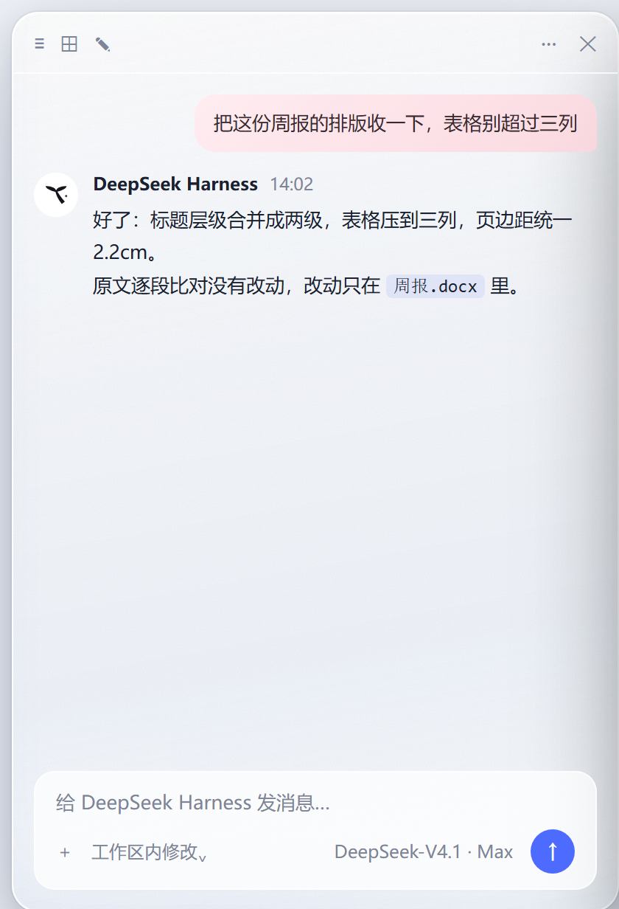
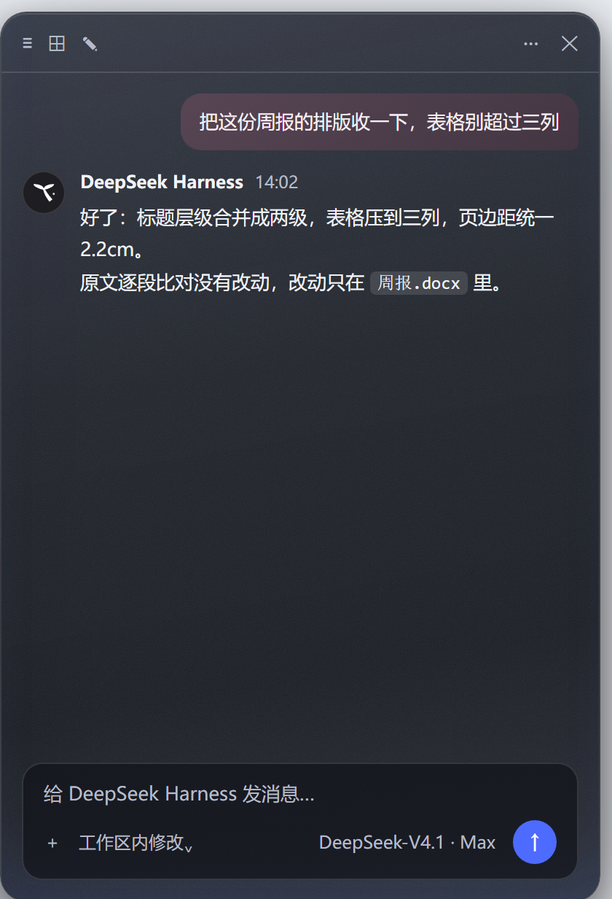
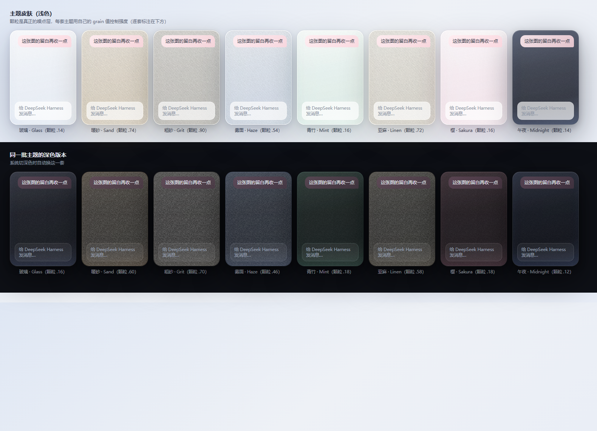

# Whale-tail Ball · dsh-whale-ball

A tiny floating ball for Windows that puts the DSH session you are already in one click away.

It is **not** a separate chat client: the ball shows the same DSH session — same model, same permission mode, same reasoning effort, same approval cards, same balance. Closing the ball does not stop your tasks; closing DSH removes the ball.


The expanded panel (both images are rendered from the real styles with placeholder content, not a real conversation):

| Light | Dark (Midnight skin) |
| --- | --- |
|  |  |

## Relationship to upstream (please read)

This is a **fork of [han8421/dsh-desktop-ball](https://github.com/han8421/dsh-desktop-ball) 0.19.0**, with a reworked appearance and interaction layer. Upstream is MIT licensed; its full copyright notice is kept in `LICENSE`, and the modification is stated here as that licence requires.

- Upstream author: **han8421**
- Package name and plugin id are changed to `dsh-whale-ball` / `whale-ball`, so installing this does **not** overwrite the original.

## Requirements

- **Windows 10 1809+ / Windows 11** — the native half is WinForms + WebView2 + PowerShell; other platforms will only error out
- **WebView2 Evergreen Runtime** (bundled with Windows 11)
- **DSH 0.2.1-rc.2 – 0.3.0** (`engines.dsh`, same range as upstream)

## Install

The ball starts with DSH and remembers where you put it.

1. From the plugin market: search for `dsh-whale-ball`.
2. Or `npm install dsh-whale-ball` inside your DSH profile directory, then add `dsh-whale-ball` to `dsh.profile.bundles` in that directory's `package.json` and restart DSH.
3. Or clone this repository and link the directory into the profile.

## What it feels like

- **Click to open, click again to close** (upstream closes on double-click)
- **Drag it to a screen edge and it hides half-way**, leaving half a ball visible; click to open
- **Hover for the balance card**, placed at the cursor
- **Right-click** the ball to change icon/background; **"⋯"** opens themes, colour mode, new chat, history and close
- **History** switches sessions in place, with `‹` to go back one level
- **Archived sessions (deleted in DSH) are not listed**

## Themes

Eight skins, each with a light and a dark palette that follow the system theme, plus a three-way colour mode lock.

| | | | |
| --- | --- | --- | --- |
| Glass | Sand | Grit | Haze |
| Mint | Linen | Sakura | Midnight |



- **The weave is real weave**: CSS-drawn warp and weft, not a bitmap, so it stays crisp at any DPI. Grit/Sand/Linen read as fabric; Glass/Mint/Sakura/Midnight stay clean.
- **Grain**: per-skin noise strength; dark mode drops the weave and keeps the grain.
- **Custom**: pick your own base and accent colour, grain low/medium/high (one knob drives grain and weave together).
- **Colour mode**: follow system / light / dark. A dark skin (Midnight) stays dark in every mode.


## What this fork changes

Appearance and interaction only — nothing inside DSH itself is patched:

- **Ball**: whale-tail vector icon that follows the system theme; 48 DIP default (44–84 selectable); click toggles open/close; drag to an edge to hide half; position stored as a fraction of the monitor's work area so it survives monitor changes.
- **Appearance layer** (new): eight skins with real weave and grain, custom colours, three-way colour mode, 412×608 DIP panel, balance card at the cursor.
- **Sessions**: history reads DSH's own session list (not just sessions this panel has seen), hides archived ones, drops rows whose session no longer exists, and removes the misleading "clear chat history" button.
- **Permissions**: adds an "auto review" entry wired to `@deepseek-ai/dsh-experimental-auto-review`, and fixes the permission pill showing the wrong label.
- **Details**: window is not always-on-top by default; frosted panel; dark palette lifted to the layer so popovers cannot keep black text; bilingual strings for everything new.

## Known limitations

- **Windows only.**
- **The panel is not truly transparent**: WinForms + WebView2 hosts an HWND, so the window cannot show the desktop through itself; the frost is simulated.
- **Do not install alongside upstream** `dsh-desktop-ball`: both use `%LOCALAPPDATA%\dsh-quick-chat` and will overwrite each other's settings.
- If you kill the ball process, only restarting DSH brings it back.

## Development

There is no build step: `index.js` is the host half, `client.js` the UI half, and `native\ball.ps1` is launched by PowerShell at runtime.

```powershell
node --check index.js
node --check client.js
```

## Licence

MIT. Upstream copyright belongs to [han8421](https://github.com/han8421) and dsh-desktop-ball contributors; see `LICENSE` for the full notice and this project's modification statement.

The whale-tail icon is an original vector drawn for this project. The official DSH whale logo is not part of this project.
