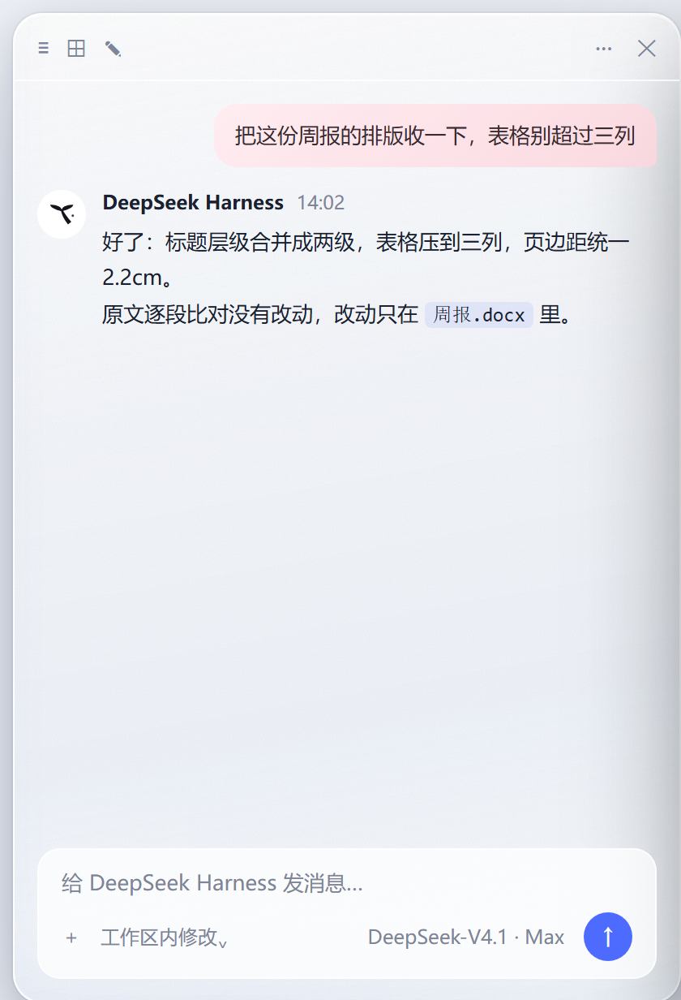
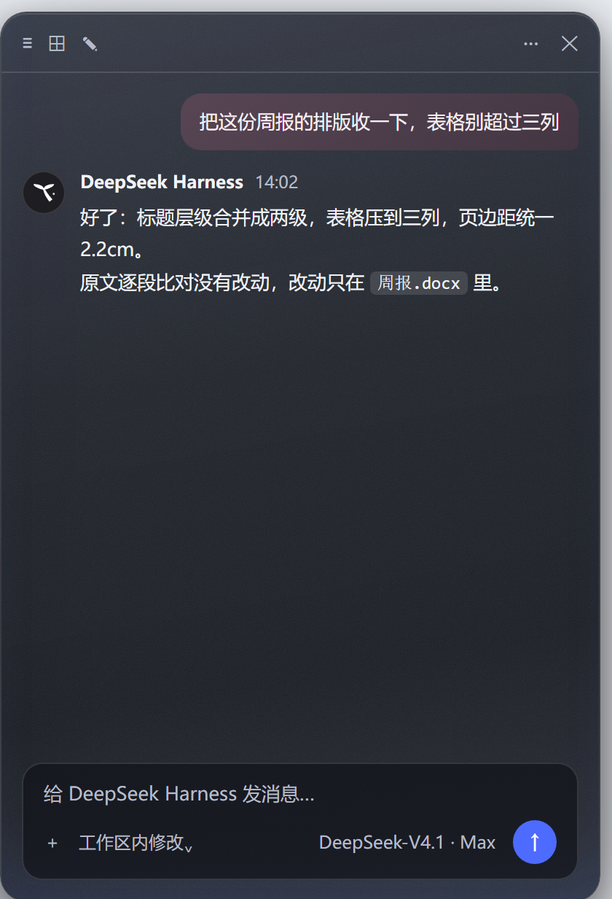
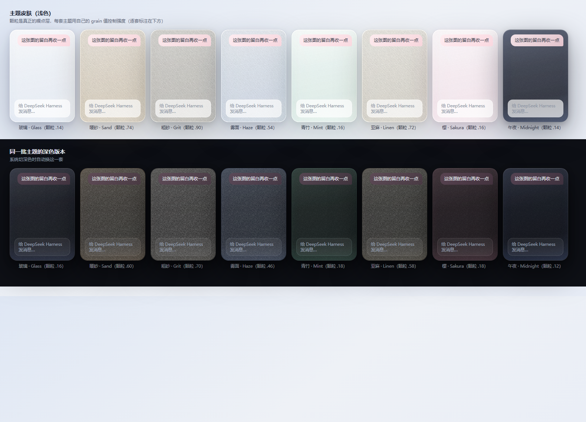

# 鲸尾悬浮球 · dsh-whale-ball

Windows 桌面上的一个小球，点一下就在当前 DSH 会话里说话。

它不是一个独立聊天客户端：球里跑的就是你正在用的那个 DSH 会话，模型、权限、推理等级、审批卡片、余额全都沿用 DSH 本身。**关掉球不会中断任务，关掉 DSH 球才会消失。**


展开后的面板（下面两张是按真实样式渲染的界面示意，对话内容是示例，不是真实会话）：

| 浅色 | 深色（午夜皮肤） |
| --- | --- |
|  |  |

## 和原版的关系（重要）

这是 [han8421/dsh-desktop-ball](https://github.com/han8421/dsh-desktop-ball) **0.19.0 的 fork**，在原版基础上做外观与交互优化。原版是 MIT 许可，本项目保留其完整版权声明（见 `LICENSE`），并在此声明修改事实。

- 原版作者：**han8421**
- 本 fork 的改动清单见下文「本 fork 改了什么」
- 包名、插件 id 都改成了 `dsh-whale-ball` / `whale-ball`，**不会覆盖原版**

## 系统要求

- **Windows 10 1809 及以上 / Windows 11**（原生部分用 WinForms + WebView2 + PowerShell，其他平台装上去只会报错）
- **WebView2 运行时**（Win11 自带；Win10 若没有，装 [Evergreen Runtime](https://developer.microsoft.com/microsoft-edge/webview2/)）
- **DSH 0.2.1-rc.2 ～ 0.3.0**（`engines.dsh` 约束，与原版一致）

## 安装

装好后球会在 DSH 启动时自动出现，位置会记住。

**方式一：插件市场**（上架后）
在 DSH 里打开 插件 → 发现，搜索「鲸尾悬浮球」或 `dsh-whale-ball`。

**方式二：手动装包**

```powershell
# 在 DSH 的 profile 目录里装（路径按你的实际 profile 调整）
cd "$env:USERPROFILE\.dsh\profiles\desktop"
npm install dsh-whale-ball
```

然后在同一个目录的 `package.json` 里，把 `dsh-whale-ball` 加进 `dsh.profile.bundles` 数组，重启 DSH。

**方式三：从源码**

```powershell
git clone https://github.com/USER/dsh-whale-ball.git
cd dsh-whale-ball
# 用本地目录链接进 profile
```

## 用起来是什么样

- **点一下展开、再点一下收起**（原版是双击才收起）
- **拖到屏幕边缘会藏一半**，只露半个球；鼠标移开也不弹开，点一下才展开
- **悬停看余额**，一张小卡片，鼠标旁边弹出
- **右键球**：换图标、换背景；**「⋯」菜单**：主题、颜色模式、新对话、历史对话、关闭窗口
- **历史对话**里点会话直接切过去，左上角 `‹` 回到上一级
- **已归档（在 DSH 里删掉）的会话不会出现在列表里**

## 主题

8 套皮肤，浅色/深色各一套配色，随系统深浅色自动切换；也可以手动锁死。

| | | | |
| --- | --- | --- | --- |
| 玻璃 Glass | 暖砂 Sand | 粗砂 Grit | 雾面 Haze |
| 青竹 Mint | 亚麻 Linen | 樱 Sakura | 午夜 Midnight |



- **布纹是真的布纹**：不是贴图，是 CSS 线条画的经纬，缩放到任何 DPI 都不会糊；粗砂/亚麻/暖砂有明显织物感，玻璃/青竹/樱/午夜是干净的
- **颗粒**：每套皮肤有自己的噪点强度，深色模式自动关掉布纹只留颗粒
- **自定义**：选「+」自己定底色和强调色，颗粒细/中/粗三档（颗粒和布纹是一个旋钮，一起调）
- **颜色模式**：跟随系统 / 浅色 / 深色 三档，深色皮肤（午夜）在任何模式下都保持深色

深色主题下的面板与菜单：


## 本 fork 改了什么

相对原版 0.19.0，改的都是外观与交互，**没有改动 DSH 本身**：

**球体**
- 图标换成鲸尾（矢量，深浅色各一版，跟随系统主题）
- 尺寸 48 DIP（原版 60），可选 44–84
- 点一下展开/再点一下收起；拖到边缘藏一半
- 位置按「相对屏幕比例 + 屏幕标识」记住，换显示器不会跑丢

**外观层**（原版没有）
- 8 套主题皮肤 + 自定义配色，含真实布纹与颗粒
- 跟随系统 / 浅色 / 深色 三档颜色模式
- 面板尺寸 412×608 DIP，与常见桌面助手面板比例接近
- 余额卡片改为鼠标旁弹出（原版贴边时会被挡在屏幕外）

**会话**
- 历史对话列表直接读 DSH 的会话清单，不再只列本面板见过的会话
- 隐藏已归档会话；点到已删除会话会提示并从列表移除
- 删除了「清除聊天记录」按钮——它原本只清本地数组，容易让人误以为删掉了会话

**权限**
- 权限菜单增加「自动审查」项，配合 `@deepseek-ai/dsh-experimental-auto-review` 使用
- 修正权限按钮上的文案错位（选了「自动审查」却显示「完全权限」）

**细节**
- 窗口默认不置顶
- 面板磨砂质感、深浅色变量上提到整层，避免弹层文字发黑
- 多语言补齐中英文新条目

## 已知限制

- **只在 Windows 上工作**，其他平台装上去会报错
- **面板不是真透明毛玻璃**：WinForms + WebView2 是 HWND 宿主模式，宿主窗口做不到「透出桌面再模糊」；这里是模拟的磨砂质感
- **不要和原版 `dsh-desktop-ball` 同时装**：两者共用同一个数据目录（`%LOCALAPPDATA%\dsh-quick-chat`），会互相覆盖设置
- 球的进程由 DSH 启动时拉起；球被手动结束后，只有重启 DSH 才会重新出现

## 从源码跑

不需要构建步骤：`index.js` 是宿主半边，`client.js` 是界面半边，原生部分由 `native\ball.ps1` 在运行时用 PowerShell 拉起。

```powershell
node --check index.js
node --check client.js
```

## 许可与致谢

MIT。原版版权归 [han8421](https://github.com/han8421) 与 dsh-desktop-ball contributors，本项目在其基础上修改，详见 `LICENSE`。

鲸尾图标为本项目自绘的原创矢量；DSH 官方鲸鱼标志不属于本项目。
